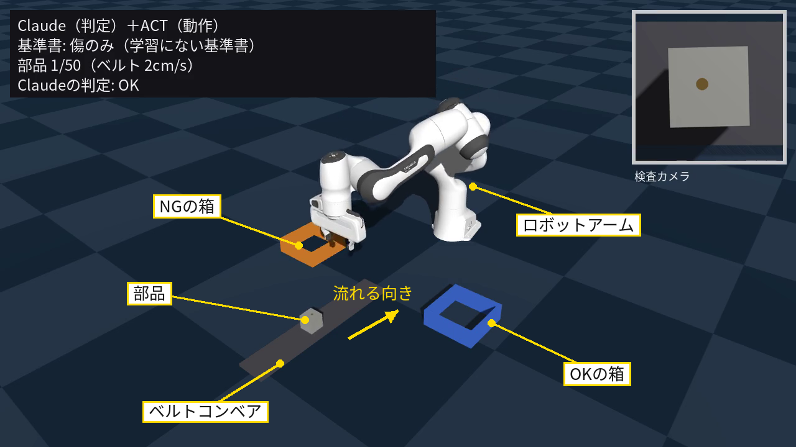
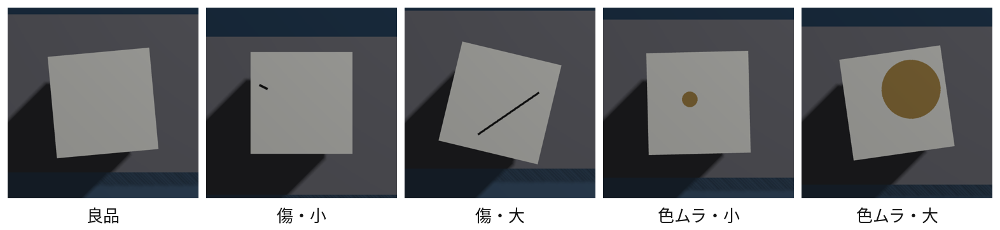
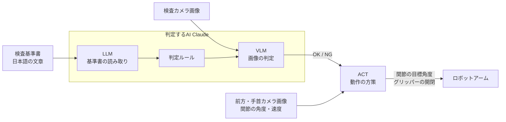

# 検査基準書を読んで仕分けるAI検品アーム

提出者：kurata_123

- 動画：https://youtu.be/7UCoAdr0RrY
- コード：https://github.com/kura123/ai-inspection-arm

## 要約

ベルトコンベアで流れてくる部品をカメラで検査し、OKの箱とNGの箱に仕分けるロボットアームを、シミュレーション上に構築した。
判定は、LLMとVLMが文章で書かれた検査基準書を読んで行う。基準書を差し替えるだけで、同じ部品の仕分け先が変わる（2種類の基準書で各50個、すべて正解）。
部品をつかむ動作は、カメラ画像から模倣学習した方策（ACT）が担う。ベルトの速度を教えなくても、画像だけで速度の違いに合わせてつかめた（44/50。正確な速度を知るスクリプトは50/50）。
さらに、判定も動作も1つのモデルで行うVLAと比べた。学習にない基準書（色ムラは問題にしない）を渡すと、VLAは学習時と同じく大きな色ムラをすべてNGに仕分けたが、判定と動作を分けた構成は、基準書を差し替えるだけで正しく判定できた（50/50）。

## 1. 概要

シミュレータ（Genesis）上に、小さな検品ラインを構築した。ロボットアーム（Franka Emika Panda）の前をベルトコンベアが通り、その両側にOKの箱とNGの箱を置いている（図1）。

**図1**：検品ラインの全体（評価動画の1コマ。左上は動画の字幕、右上は検査カメラの画像）

部品は一辺5cmの立方体で、上面に次のいずれかがある（図2）。

- 欠陥なし（良品）
- 傷（小・大）
- 色ムラ（小・大）

**図2**：部品5種類の見た目（左から良品、傷・小、傷・大、色ムラ・小、色ムラ・大）

部品は1個ずつベルトを流れ、速度は2〜6cm/sの間で毎回変わる。ロボットは次の流れで1個ずつ仕分ける。

1. 部品が流れ始めるとき、真上の検査カメラで1枚撮影する
2. 検査基準書に従って、OKかNGかを判定する
3. ベルトを止めずに、流れている部品をつかむ
4. 判定に応じて、OKの箱かNGの箱に入れる

検査基準書は日本語の文章で、次の3種類を用意した。

| 基準書 | 内容 |
|---|---|
| 標準 | 小さな傷・色ムラは許容 |
| 厳格 | 傷・色ムラが少しでもあればNG |
| 傷のみ | 色ムラは問わない |

同じ部品でも、基準書によって仕分け先が変わる。

## 2. 目的

### 背景

製品の外観検査では、何をNGとするかの基準が一定ではない。同じ部品でも、製品の用途や取引先、時期によって基準が変わる。こうした基準は、多くの場合、人が読む文章（検査基準書）として管理されている。

一方で、ロボットに検査や仕分けをさせるには、基準ごとにプログラムを書き換えるか、データを集め直して学習し直す必要がある。また、生産ラインは止まらずに流れ続けるため、ロボットには、流れる速度のばらつきに合わせて部品を扱うことも求められる。

### 目的

そこで本課題では、**検査基準書の文章を差し替えるだけで判定が切り替わり、流れ続けるベルトから部品をつかんで仕分けられる検品アーム**を目指した。

### 確かめたこと

1. 文章の基準書を読んで、基準どおりに判定できるか
2. ベルトの速度を教えなくても、カメラ画像を見て部品をつかめるか
3. 判定と動作を1つのモデル（VLA）で行う場合と比べて、どちらの構成が基準の変更に強いか

## 3. システム構成

本システムは、**判定するAI**と**動くAI**の2つで構成する（図3）。

**図3**：システム構成

### 3.1 判定するAI（Claude Opus 5.5）

1. **基準書の読み取り（LLM）**：日本語の検査基準書を読み、欠陥の種類ごとにNGとなる条件（例：傷が一辺の1/3以上ならNG）を、決まった形式のルールに変換する。基準書1つにつき1回だけ行う。
2. **画像の判定（VLM）**：検査カメラの画像と上のルールを受け取り、欠陥の種類と大きさを読み取って、OKかNGかとその理由を出力する。

### 3.2 動くAI（ACT）

模倣学習の方策ACT（LeRobot）で、アームの動きを出力する。

| | 内容 |
|---|---|
| 入力 | 前方カメラと手首カメラの画像、関節の角度と速度、入れる箱（判定するAIの結果） |
| 出力 | 7つの関節の目標角度とグリッパーの開閉 |
| 制御 | 1秒に20回、関節の目標角度とグリッパーの開閉を出す。0.5秒ごとに、画像を見て先の動きを予測し直す |
| 学習データ | 部品の正確な位置と速度を使うスクリプトで、150回分のお手本を作成した。方策には、位置も速度も渡さない |

### 3.3 比較用：判定と動作を1つにしたVLA（SmolVLA）

比較のため、公開済みのVLA（SmolVLA）を追加学習した構成も用意した。基準書の英語の要約文と3台のカメラ画像から、判定と動作を1つのモデルで行う。入れる箱は与えない。

**使用環境**：Genesis 1.4.5、Franka Emika Panda、Claude Opus 5.5、LeRobot 0.6.1

## 4. 工夫した点

### 4.1 基準書の文章をそのまま判定に使う

- 課題：基準をプログラムに書き込むと、基準が変わるたびに改修が必要になる。
- 工夫：
  - 判定を2段階に分けた。LLMが基準書を「欠陥の種類ごとのNG条件」というルールに変換し、VLMが画像とルールから判定する。
  - ルールの変換は、基準書1つにつき1回で済む。
  - ルールも判定結果も、決まった形式（構造化出力）で受け取るので、プログラムで扱いやすい。
  - VLMには判定の理由も出力させ、なぜNGにしたかを人が確認できるようにした。
- ねらい：基準書のファイルを差し替えるだけで、判定が切り替わる。学習もプログラムの改修も必要ない。

### 4.2 流れ続けるベルトから、速度を教えずにつかむ

- 課題：実際のラインでは、流れる速度が一定とは限らない。速度を決め打ちした動きでは、速度がずれると部品をつかめない。
- 工夫：
  - お手本作り：お手本は、部品の正確な位置と速度を使えるスクリプトで作った。学習する方策（ACT）には、位置も速度も渡さず、カメラ画像だけから動きを学ばせた。
  - 学習データ：ベルトの速度はエピソードごとに2〜6cm/sの間で変えた。
- ねらい：速度を測る仕組みを作り込まなくても、画像を見るだけで速度の違いに合わせてつかめる。

### 4.3 一体型のVLAと公平に比べ、構成を選んだ根拠を示す

- 課題：判定と動作を分けるか、1つのモデル（VLA）にまとめるかは、設計上の大きな分かれ目である。どちらが良いかは、実際に比べないと言えない。
- 工夫：
  - VLAにも同じ検査画像（512×512の検査カメラ）を与え、小さな欠陥を見分けられるようにした。
  - 学習にない基準書「傷のみ」を用意した。学習した基準書とは、色ムラ・大の正解が逆になる（NG→OK）。見た目だけで覚えたモデルなら、ここで間違えるように設計した。
  - 2つの構成には、同じ部品・同じ順番・同じ速度で評価を行った。
- ねらい：「学習した範囲での性能」と「新しい基準への対応力」を分けて測る。

## 5. 結果

### 5.1 基準書の読み分け

部品50個（5種類×10個）を、標準と厳格の基準書でそれぞれ判定・仕分けした。この実験は判定を評価するためのもので、アームの動作には、部品の正確な位置を使うスクリプトを用いた。

| 基準書 | 判定の正解 | 正しい箱に入った数 |
|---|---|---|
| 標準 | 50/50 | 50/50 |
| 厳格 | 50/50 | 50/50 |

傷・小と色ムラ・小は、標準ではOKの箱、厳格ではNGの箱に仕分けられた。基準書を差し替えるだけで、同じ部品の仕分け先が変わることを確認した。

### 5.2 流れ続けるベルトでの把持

ベルトの速度を2〜6cm/sの5段階とし、各10個（計50個）で比べた。成功は、正しい箱に入ったことで判定した。

| 方式 | 速度の情報 | 2cm/s | 3 | 4 | 5 | 6cm/s | 合計 |
|---|---|---|---|---|---|---|---|
| スクリプト（4cm/sを仮定） | なし（固定値） | 0 | 8 | 10 | 3 | 0 | 21/50 |
| **ACT** | **なし（画像のみ）** | 5 | 9 | 10 | 10 | 10 | **44/50** |
| スクリプト（正確な速度を使用） | あり | 10 | 10 | 10 | 10 | 10 | 50/50 |

2つのスクリプトは、速度を知らない場合と、完全に知っている場合の参考値である。ACTは速度を教えられていないが、正確な速度を知る場合（50/50）に近い成功率となった。失敗の多くは2cm/sで、つかんだ部品を運ぶ途中で落としたものだった。

### 5.3 一体型VLAとの比較

**(1) 学習した基準書（VLAのみ、各50個）**

| 基準書 | 成功 | 箱に入った部品のうち、正しい箱 | つかめなかった |
|---|---|---|---|
| 標準 | 38/50 | 38/38（100%） | 12 |
| 厳格 | 42/50 | 42/42（100%） | 8 |

学習した範囲では、VLAは指示文に従って行き先を変え、箱に入った部品はすべて正しい箱だった。失敗はすべて、部品をつかめなかったものである。

**(2) 学習にない基準書「傷のみ」（同じ部品・順番・速度で50個）**

| | VLA | Claude＋ACT |
|---|---|---|
| 成功 | 32/50 | **41/50** |
| 判定の誤り | 10（色ムラ・大をすべてNGに） | **0**（判定50/50） |
| 動作の失敗 | 8 | 9（うち8は2cm/s） |

VLAは学習時と同じく、大きな色ムラをNGの箱に入れた。Claude＋ACTは、基準書を差し替えるだけで正しく判定した。Claude＋ACTの失敗はすべて動作によるもので、5.2で見たACTの弱点と同じだった。

## 6. 考察・反省点

### 6.1 判定と動作を分ける構成の利点

- VLAは、学習した2つの指示文の違いには従えたが、学習にない指示文の意味を読み取って判定を変えることはできなかった。
- 学習に使った指示文は2種類だけだったため、VLAにとって指示文は、実質的に「どちらの基準か」を表すラベルとして働いたと考えられる。
- 一方、判定をLLM・VLMに任せた構成では、基準書を差し替えるだけで新しい基準に対応できた。
- 基準が変わりうる検査の現場では、判定と動作を分ける構成のほうが運用しやすいと考える。

### 6.2 VLAとの比較の限界

今回の比較は、VLAに不利な条件を含む。

- 学習した基準書は2種類だけで、言い換えも含めていない。
- VLAの言語・画像部分（VLM）は凍結し、動作部分だけを学習した。
- 指示文は、SmolVLAの既定の設定（48トークンまで）に収まるよう英語で要約したもので、Claudeに渡した日本語の基準書とは形式が違う。
- SmolVLAは約4.5億パラメータの小型モデルであり、判定に用いた大規模言語モデル（Claude）とは規模が大きく異なる。

基準書の種類を増やす、VLMも学習するといった方法で、VLAが新しい指示文に対応できる可能性はあるが、試していない。

### 6.3 動作の課題

- **ACTの弱点**：遅い速度（2cm/s）で、つかんだ部品を運ぶ途中に落とすことが多い。原因は特定できておらず、お手本の追加や把持の仕方の見直しが必要である。
- **VLAのつかみ損ね**：VLAは、学習した基準書でも50個中8〜12個をつかめなかった。ベルトでのつかむ動作は、ACT（44/50）よりやや弱い。
- **比べていない方式**：2つのスクリプトは参考値である。現実的な方式である「カメラで部品の位置を検出して速度を推定し、到着位置を予測してつかむ」作り方とは比べていない。その方式のほうが、成功率が高い可能性がある。ACTの利点は、こうした処理を人が作り込まなくても、お手本から学べる点にある。

### 6.4 検証の範囲

- すべてシミュレーション上の検証で、実機では試していない。
- 部品は単純な立方体で、欠陥は傷と色ムラの2種類・大小2段階に限られる。
- Claudeの判定にかかる時間は考慮していない（判定の間はシミュレーションを止めた）。実際のラインでは、判定が部品の到着に間に合うかを考える必要がある。

## 7. まとめ・今後

### まとめ

検査基準書を読んで仕分けるAI検品アームをシミュレーション上に構築し、次のことを確認した。

1. LLMとVLMにより、文章の基準書に従って判定でき、基準書の差し替えだけで判定が切り替わった。
2. 模倣学習した方策（ACT）は、ベルトの速度を教えなくても、画像を見て速度の違いに合わせて部品をつかめた。
3. 判定と動作を1つにしたVLAは、学習にない基準に対応できなかった。基準が変わる現場では、判定と動作を分ける構成が有効である。

### 今後

- **実機での検証**：実物の部品とカメラで、判定と把持が成り立つかを確かめる。
- **把持の改善**：遅い速度で部品を落とす問題について、原因を調べ、お手本の追加や把持の仕方を見直す。
- **VLAの再検証**：基準書の種類や言い換えを増やす、VLMも学習するなどの条件で、新しい指示文に対応できるかを確かめる。
- **判定時間への対応**：判定にかかる時間を測り、部品の到着までに判定が間に合うライン設計（検査カメラとアームの距離など）を検討する。
